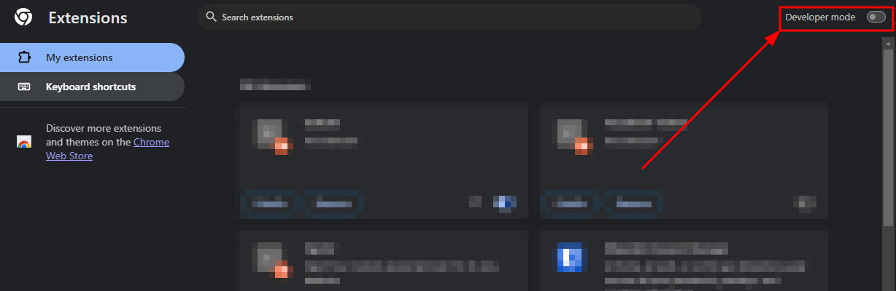
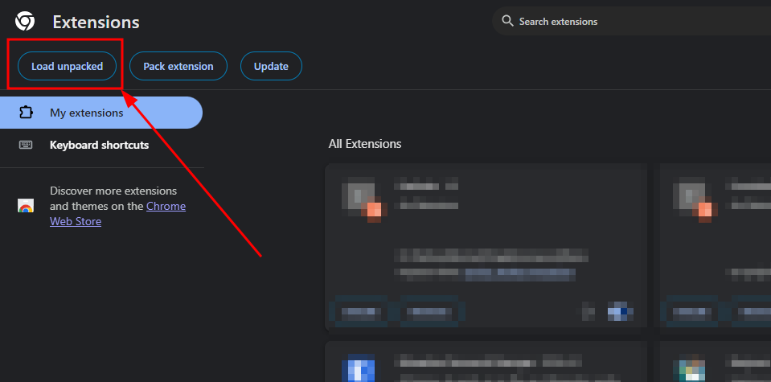
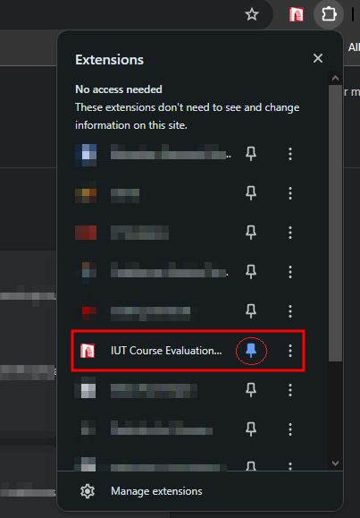
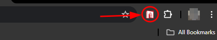
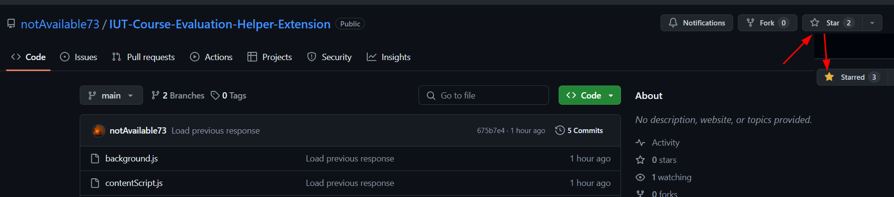

# IUT Course Evaluation Helper Extension

IUT Course Evaluation Helper is a Chromium and Firefox browser extension for quickly filling IUT SIS course evaluation forms.

It works only on:

- `https://sis.iutoic-dhaka.edu/evaluate-course/*`
- `https://sis.iutoic-dhaka.edu/evaluation-list*`

## Features

- Save a default numeric rating from 1 to 5.
- Save reusable text feedback.
- Auto-fill every text box with your default text as soon as a course evaluation page opens (can be switched off).
- Fill the text boxes on demand with **Fill Text Boxes Now**.
- Fill and submit the currently opened course evaluation form.
- Submit all course links found on the SIS evaluation list page.
- Show success and error status directly inside the popup.
- Link users to the project repository to give it a star.
- Use only the required SIS host permission instead of broad all-site access.

## Installation

This extension works in Chrome, Microsoft Edge, other Chromium-based browsers, and Firefox 140+.

### Chromium browsers

1. Download the extension source code from GitHub.
2. Extract the downloaded archive.
3. Open your browser's Extensions page.
4. Enable **Developer mode**.

   

5. Click **Load unpacked**.

   

6. Select the extracted extension folder.
7. Pin the extension from the browser toolbar.

   

Chrome may list a warning about the unrecognized `browser_specific_settings` key. It is only used by Firefox and is safe to ignore.

### Firefox

1. Download and extract the extension source code.
2. Open `about:debugging#/runtime/this-firefox`.
3. Click **Load Temporary Add-on...** and select the `manifest.json` file in the extracted folder.
4. Open `about:addons`, click the extension, open the **Permissions** tab, and make sure access to `sis.iutoic-dhaka.edu` is allowed.

Temporary add-ons are removed when Firefox closes. To keep it permanently, either submit the folder as a zip to [addons.mozilla.org](https://addons.mozilla.org/developers/) as an **unlisted** add-on to get a signed `.xpi`, or use Firefox Developer Edition / Nightly / ESR with `xpinstall.signatures.required` set to `false` in `about:config`.

## Usage

### Auto-fill Text Boxes

1. Click the extension icon and type your default text in **Default Text**. It is saved as you type.
2. Keep **Auto-fill text boxes when a course page opens** ticked.
3. Open any course from the evaluation list. Empty text boxes are filled automatically; boxes that already contain text, and anything you edit afterwards, are left alone.
4. To fill the boxes on the current page yourself, click **Fill Text Boxes Now**. This overwrites the existing text in those boxes.

### Fill and Submit One Course

1. Open an unevaluated course from `https://sis.iutoic-dhaka.edu/evaluation-list`.
2. If the page was opened before installing or reloading the extension, refresh the page.
3. Click the extension icon.

   

4. Select the default rating and enter text feedback.
5. Click **Fill & Submit Current Course**.
6. The extension fills the form, clicks the SIS submit button, and returns the tab to `https://sis.iutoic-dhaka.edu/evaluation-list`.

### Evaluate All Listed Courses

1. Open `https://sis.iutoic-dhaka.edu/evaluation-list`.
2. Click the extension icon.
3. Select the default rating and enter text feedback.
4. Click **Evaluate All Listed Courses**.
5. Wait for the popup status message to show how many course submissions succeeded.

## Notes

- The extension can only work while you are logged in to SIS.
- If SIS changes its course evaluation form or API, the bulk submit feature may need an update.
- The popup disables actions that do not apply to the current page.
- Auto-fill only runs on `/evaluate-course/` pages and never changes the rating.

## Troubleshooting

- If the popup says to open an SIS evaluation page, make sure the active tab is on the course evaluation form or evaluation list.
- If the extension was loaded after a SIS page was already open, reload that SIS page.
- If a bulk submission fails, confirm that you are logged in and that course links are visible on the evaluation list.
- If the extension icon is missing, confirm that the extension is enabled and pinned.

## Like the Project?

- Don't forget us from your Du'a! 🤲
- If you like the project, please consider giving it a star: `https://github.com/notAvailable73/IUT-Course-Evaluation-Helper-Extension`
- The popup also includes a GitHub star link.

  
